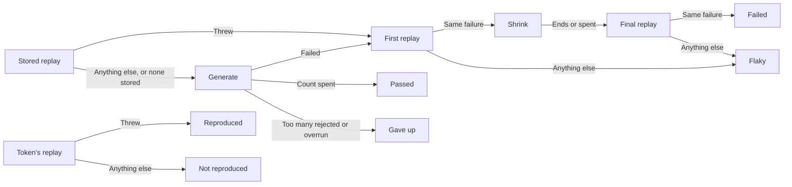
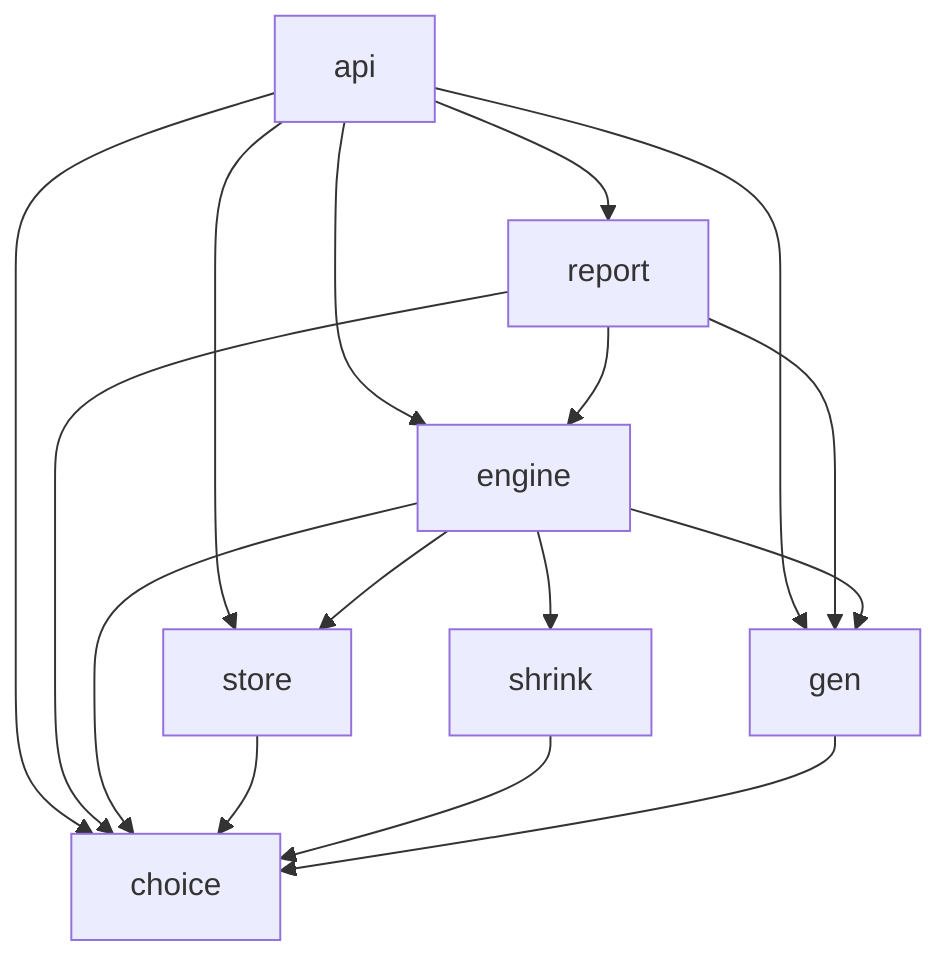

# Architecture

A property's body draws its inputs through a choice source, and every choice it makes is recorded as a natural number. A search runs the body on random choices until it fails. Shrinking then works on the record alone, never on the value, so a structured input shrinks whole.

The shrinker is a pure step function that imports nothing of grit's but `choice`, the bottom of seven layers that import downward alone. Only `api` and `store` touch I/O, so everything that generates, shrinks and reports is tested with no files and a fake clock.

## Choices

A choice is a natural number from 0 to its bound, and 0 is the simplest. Every generator is built on choices, by an encoding that gives simpler values at smaller choices: an integer zigzags out from the value it shrinks towards, and a float takes an order that puts simple floats first.

A run is one execution of the body. Its record is its sequence of choices. One sequence is smaller than another when it is shorter, or the same length and smaller at its first difference. That order, shortlex, is the one every part of grit means by smaller. A span is a stretch of consecutive choices in one sequence. A draw's span is the stretch its draw made, the draws inside it among them, and a run records each draw's span beside its sequence, in the order the draws began, with how many draws were in progress around it.

The choice source hands a run its choices. In generation it fills each at random, up to a limit on the choices one run may make. A candidate in shrinking, and a replay, hand over a fixed sequence and never fill, so a run that asks for more than the sequence holds ends there.

A run ends in one of four statuses:

| Status | Means |
|---|---|
| `overrun` | More choices asked for than the source holds, past a fixed sequence's end or generation's limit |
| `rejected` | An `assume` that was false, a filter that gave up, a set short of its minimum size once its retries were spent, or a fixed sequence's choice above the bound its generator asks for |
| `returned` | A body that returned |
| `failed` | A body that threw |

## A search

A search is everything grit does for one property: its runs, its shrinking and its replays, ending in the property's outcome. A property whose `replay` setting holds a token runs a token's replay in place of a search.



| Phase | Runs | Ends on |
|---|---|---|
| Stored replay | The sequence the store holds for the call site, where it holds one | A throw, which is the first failure, or anything else, which passes the search to generation |
| Generate | The body on random fills, one run after another | A failure, the run count spent, or too many runs rejected or overrun |
| First replay | The first failure's sequence again | The same failure, or anything else, which makes the outcome flaky |
| Shrink | The candidates the step function proposes | The step function's end, or the budget spent |
| Final replay | The smallest failing sequence, the choices its run read and no more | The error and the draws for the report, or anything else, which makes the outcome flaky |
| Token's replay | The token's sequence, once, with no generation, no shrinking and no store | A throw, the case reported unshrunk, or anything else, which fails the test saying the token no longer reproduces and how its run ended |

An error grit's own code throws inside a draw is a bug in grit, never the property's failure. A draw keeps each error thrown out of it, and where one's first frame outside the Dart SDK is grit's, and no `map` or `filter` callback threw it, the run throws it on as it was thrown, out of whichever phase it is in, with no outcome and the store as it stood, whether or not the body caught it. The test then fails on grit's error, unshrunk. A generator built inside a draw from arguments out of range throws from grit's code too, so it ends the test the same way, its error naming the argument. A callback's error is the property's whatever its frames, since a Dart SDK tear-off handed to `map` has no frame of the consumer's.

A stack overflow can strike part way through one of grit's writes to a run's records, the draw's or the choice source's, and leave it half-written, such as a list with a slot and no value in it. Each write keeps the error that cut it short. From then on the draw's records, read once the run ends, throw that error, as do the choice source's record, its length and every choice asked of it, so the run ends on the overflow, out of whichever phase it is in, never on an error from a record read half-written. The draw's own reads inside the run, of a list's length, its last error and its callbacks' errors, go unguarded, since whatever they find, the run ends on the error that cut the write at its first read of the records once it ends.

A note is kept by one store of a field, the line holding each line noted before it, so no overflow leaves the notes half-written, and a note is never a write that cuts. An overflow as the body notes, outside any draw, is the property's failure like any other its own code meets.

A failure the stored replay found takes the path generation's would, from the first replay on, so a stored failure that no longer fails alike is flaky. Once a search ends, the store holds a failed outcome's smallest sequence for its call site, and nothing after any other outcome.

The outcome is a sealed type, one subtype per row:

| Outcome | Carries |
|---|---|
| Passed | The run count |
| Failed | The smallest failing sequence, its error and draws, whether the stored replay or generation first found it, the steps and time shrinking took, and the budget's bound that ran out, where one did |
| Flaky | The failing sequence, whether the stored replay or generation found it, and the replay that did not fail as it did |
| Gave up | How many runs were rejected and overran |
| Reproduced | The token's replay, which threw |
| Not reproduced | The token's replay, which returned, was rejected or overran |

Every outcome carries the search's warnings, which never change its verdict: a slow property, mostly invalid runs, where those rejected and overrun outnumber those that returned in a search that did not give up, and a stored failure that decodes to no sequence, deleted unread. A token's replay warns of nothing, and no one who reads an outcome's warnings can change them. A pass that warns prints its report under its test, and a failure's report carries them. `runProperty` returns the outcome, and `property` and `forAll` are its bindings to `package:test`, failing the test on every outcome but passed. The report is a pure function of the outcome, the seed the search filled from and the settings it ran under, which it names so the search can be repeated, where the search generated from the seed. A failed outcome's report prints the token of its smallest sequence, says where the stored replay first found it, and says the seed repeats its search only where generation found its failure, and then only once the store no longer holds it. A failure the stored replay first found names no seed, since its search drew nothing from one: a failed one's report says the next search replays it first, and a flaky one's that the store's failure is deleted, so the next search generates afresh.

## Shrinking

The shrinker is a step function: it proposes a candidate sequence, is told whether the candidate's run failed as the first failure did, with the spans of its draws where it did, and proposes the next. It is pure, so async, time and I/O stay with the engine, which drives it, awaits each run and holds the budget.

The engine decides what counts as the same failure: the same error type, thrown from the same frame. The frame is the first in the package of the property's call site, or where none is, the first outside the Dart SDK and every test package, grit's among them. A stack overflow is the same failure as another whatever their frames, since one recursion's overflow strikes in whichever of its frames the stack runs out, and that turns on how much stack each frame took. A candidate that fails any other way is told to the shrinker as not failing, so a case never slips from one bug to another, but for one cost: a property with two unbounded recursions can shrink from one's overflow to the other's. The first and final replays hold to the same rule. The stored replay and a token's replay take any throw as a failure, since neither has a failure to compare with.

Why shrinking always ends:

- The shrinker accepts a candidate only where it is smaller than the current sequence and failed as the first did, and takes the record its run read, no larger than the candidate, so every accepted step descends shortlex.
- Shortlex has no endless descent, though a choice is any natural number, so the accepted steps are finitely many.
- Each pass proposes finitely many candidates from one sequence and the spans its run made, and the passes are finitely many.
- The step function ends on a round of every pass that accepts nothing.

The budget then bounds how long shrinking takes, never whether it ends. It counts steps, each one run of a candidate, and wall time from shrinking's start, with defaults in `api`'s settings that no consumer has to set. No replay is a step, nor is a candidate the step function proposes again in one shrinking, which the engine tells its answer with no run. A spent budget ends shrinking at the smallest failing sequence found so far.

A pass is a function from the current sequence, and the spans its run made, to its candidates, and the step function chooses among them:

- Deleting a span, alone and with the choice before it lowered by one, since that choice may be the span's length, a span whose deletion leaves the pass no candidate at its place tried again, so a length drawn before its elements falls by more than one a round.
- Lifting a draw's span into the place of a draw it sits in, so a part of a value takes the place of the part around it.
- Zeroing a span.
- Lowering a choice by binary search, over the pairs of choices an integer's zigzag puts at one distance, so a value lowers on either side of the one it shrinks towards.
- Lowering two choices by the same amount, so two values tied to each other fall together.
- Sorting a span, and swapping two.
- Swapping two sibling draws' spans, two with the same draw around both or two the property's body made, so two parts of a value change places whatever their widths.
- Moving value from one choice to another, a pair whose value moved part way tried again from moving the whole of it.
- Deleting a span just before two choices, both lowered by one, since those may be indices that count the elements before them.
- Lowering a choice, with a later 0 set to the choice after it, so an empty branch takes the branch the next draw took.
- Deleting a span with the choice after it raised by the span's sum, so a list's element folds into the positive integer after it.

The last three are costly: each proposes candidates that rarely fail where a cheaper pass has not, so a round takes them only where it has accepted nothing yet.

A pass for one kind of value, floats or strings, is added where shrink quality shows the need. It needs the record to carry each draw's kind beside its span, since a span alone cannot say what kind of value its choices make, and that change is settled with the pass.

The step function's current sequence is always the record a run read that it was told failed: the first failure's, or the choices a candidate's run read, which may leave the candidate's tail unread. The current sequence is so the smallest failing record found, and the outcome reports it. The final replay then holds that every sequence the outcome reports as failed still fails.

## The clock

Wall time is read in three places alone:

- The budget's bound on shrinking.
- The time shrinking took, which `Failed` carries.
- The slow-property warning.

None changes a verdict.

Generation is timed, from its first run to its last. A property whose run count, at generation's mean time per run, costs more than the engine's threshold of 5 s, with no setting, gets a warning on its outcome naming its time per run, so its owner can lower the count.

## The API

A property's body takes a `Draw` and pulls each input as it needs it. No arity is chosen up front, a draw can depend on one before it, and a body may be async and await as any test does:

```dart
property('sorting twice is sorting once', (draw) {
  final List<int> xs = draw(.list(.integer()));
  expect(sort(sort(xs)), sort(xs));
});
```

`Gen.build` takes a synchronous body of the same shape to make a reusable generator, and `Gen`'s static members are its generators, named by dot shorthand wherever a `Gen` is expected.

| Entry | Is |
|---|---|
| `property` | A test declared with no timeout, taking `test`'s `testOn`, `skip`, `tags`, `onPlatform` and `retry` |
| `forAll` | A search inside a test that stands, such as a `testWidgets`, bounded by that test's own timeout |
| `runProperty` | A search returning its outcome, with no test failed |
| `Draw.call` | A value drawn from a generator, with an optional label the report prints |
| `Draw.assume` | A run rejected where its condition is false |
| `Draw.note` | A line added to a failing run's report |

The public surface is `lib/grit.dart` alone, exporting `api`, `gen` and the outcome. The engine, the shrinker, the store and the choice source stay in `lib/src/`, each tested through its own public members there, the engine with the fake clock and the in-memory store.

## Generators

The rules every generator obeys:

- Choices: drawn only through the choice source, with no `Random` of its own and nothing else read.
- Simplest value: named in its doc comment, the one choice 0 gives.
- Collections: each element behind a "one more" choice, read as one more whatever it holds inside the minimum, and the collection ending on a choice of 0, one that can only be 0 at its maximum, so deleting a span deletes an element whole. A set whose draws of a distinct element are spent ends with no such choice.
- Strings: a list of code points, each one choice of its index in an `Alphabet`, simplest first, so a string's length counts code points and a string shrinks as a list does.
- Distribution: none of it. A generator sets only its choices' bounds, or the zigzag an integer's counts out along, the edge values a choice names, and a "one more" choice's odds.

The bias of early runs lives in the choice source's random fill, one home for every generator. A zigzag is how a choice's values count out from its centre, as an integer's do from its target, and a choice that counts straight up from 0 has a zigzag of one side. An early run fills most choices made along the zigzag of an earlier one beside one of those, at it or at the distance one either side of it, so two wide integers fall close in value, on one side of 0 or across it, for a failure that needs them near each other. Of the rest, it fills about half at an edge, which is 0, the bound or a value the choice names, such as an integer's other end, and the others uniformly. Before any of that, an early run fills a choice that names edges at each in turn, the first times the search makes it, so every named edge is filled whatever the seed. A choice is told from another by its bound, its edges and its place among the choices alike in both that its run made before it. A filter retries a bounded number of times, then rejects the run. A set draws again as many times where a draw repeats an element it holds, then ends where it stands, or rejects the run under its minimum.

## Layers



| Layer | Holds | Imports |
|---|---|---|
| `api` | The entries, the settings and their defaults, the binding to `package:test`, and the composition root | `report`, `engine`, `store`, `gen`, `choice` |
| `report` | The outcome as the failure message, and each warning as the line a pass prints | `engine`, `gen`, `choice` |
| `engine` | The search: generation, the replays, the shrink driver under the budget, the warnings, the outcome, and every read of a stack | `store`, `shrink`, `gen`, `choice` |
| `store` | Failing sequences under `.dart_tool/grit/` | `choice` |
| `shrink` | The step function and its passes | `choice` |
| `gen` | `Gen`, `Draw`, and every generator and combinator | `choice` |
| `choice` | A choice, the sequence and its order, a draw's span, the token, the choice source and a run's status | Nothing of grit's |

The table is the rule's home, and the rules new code obeys are:

- An import reaches only the layers its row names, so none runs up.
- Only `api` imports `package:test`.
- Only `api` and `store` import `dart:io`.
- Only `api` builds a clock, a `Random` or a store, and every other layer is handed them by constructor.
- `choice`, `shrink` and `gen` are synchronous: no `Future`, no clock and no `Random` of their own.

Each layer is a directory under `lib/src/`. A new generator is a static member of `Gen` and a file under `lib/src/gen/`.

## Seams

The outside world reaches the layers below `api` through three seams:

- The clock, a monotonic elapsed time, which grit's own suite fakes below `api`, and which no verdict turns on, so no test of grit's turns on it.
- The `Random` the choice source fills from, seeded by a setting where a search must repeat.
- The store, with a file implementation and one in-memory fake.

No other I/O stands below `api`, and nothing writes outside the consumer's `.dart_tool/grit/`.

## The store

The store keeps each call site's smallest failing sequence in a file of its own under `.dart_tool/grit/`, in the working directory `dart test` runs from, the consumer's package. No setting turns it off. Its key is the stack at the `property`, `forAll` or `runProperty` call, every frame of it in the consumer's package, by file and line. A property behind a helper is keyed by where the helper is called, and an edit above any of those lines loses its stored failure. Calls from one line in a loop share a key, so they replay each other's failure.

A file is named for a 64-bit FNV-1a hash of its key, and holds its sequence's token and nothing else. The store's file I/O is synchronous, since async file I/O can deadlock inside a `testWidgets`. A file is written in a temporary directory of its own and renamed into place, since `dart test` runs test files at once. A stored sequence whose replay does not fail, whatever its status, gives way to generation's outcome, and a file that decodes to no sequence is deleted with a warning.

The token is a sequence as one line of text: its format, `grit1`, then a colon, then each choice in base 36, lower case with no leading zero, joined by dots. Its characters all stand inside a Dart string literal as they are. Text that decodes is the one token of its sequence, so no two tokens name one. A token of another format, `grit` and other digits, says so where it fails to decode, and `Settings(replay: ...)` throws an `ArgumentError` at construction for any text that does not decode, saying which, as it does for any other setting out of range.

## Platform and packages

The web would change five things:

- `dart:io`, which the layer rules keep to `api` and `store`.
- A stack's form, read in `engine` alone.
- A bound's width under dart2js, held in `choice`.
- A double's 64 bits read as an integer, which a float's encoding in `gen` ranks by.
- The range a seed is drawn from in `api`, `1 << 32`, which is 0 under dart2js.

So the web is a later cut of those parts and not a rewrite.

grit is one package. A Flutter package under `fixture/flutter/` resolves it beside `flutter_test` and runs it inside a `testWidgets`, since `flutter_test` pins the `test_api` that grit's `test` must match. A Lean package under `lean/` models the step function and proves the statements [proofs.md](proofs.md) names, and a grit property ties the model to the Dart code.

## Testing grit

The shrinking challenge is a public set of shrinking problems, each with the smallest case known (jlink/shrinking-challenge on GitHub). It is a suite under `test/challenge/`, one file per challenge and, for each property it holds, a group of one test per seed, each driving the engine under the default settings on fixed seeds, the fake clock and an empty in-memory store, and asserting the smallest sequence's value against the smallest known, so a fall in shrink quality fails the suite.

A challenge's search finds a failure from each of the seeds from 0 to 9, and is held to the smallest known from each, and from each further seed its file names.

Each challenge carries a benchmark as well, tagged `bench`, which the suite skips and `dart test -P bench` runs alone. It searches from each seed from 0 to 99 and prints how many failed, how many of those reached the smallest known, and how many steps shrinking ran over them. The clock never moves and the seeds are fixed, so the counts repeat exactly, and a change to the passes shows its cost as the difference from a run at the tree it starts from.

grit departs from the stack's property-test row, which names glados, since it is the library that replaces it. Before `property` runs, a property a layer's issue carries is checked over every sequence up to a small length and bound, by plain loops in the test. Those checks stay once grit stands, beside the same property written on grit over larger inputs.

## Why this model

The engine is Hypothesis's model, in the small form minithesis gives it.

Why shrinking works on the record of choices:

- A generator built by `map`, `filter` or `Gen.build` shrinks with no shrinker of its own, since every value it makes is a function of the choices beneath it.
- A structured input shrinks whole, since deleting a span deletes a part of the value, wherever in it that part sits.
- A failure is stored and replayed as its choices, so a stored failure outlives a change to how its value prints.

Why every choice is a bounded natural:

- One order serves every kind of value, so the shrinker holds one set of passes, and the proof one order.
- A kind of value whose choices shrink poorly takes a pass of its own over the same naturals, so the order never grows a type per kind.

Why the body draws its inputs:

- Dart has no variadic generics, so a property of fixed arity needs a function for each arity.
- A draw that depends on an earlier one is a plain line of the body, with no `bind`.
- An async body awaits as any test's does.
