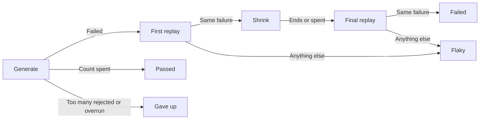
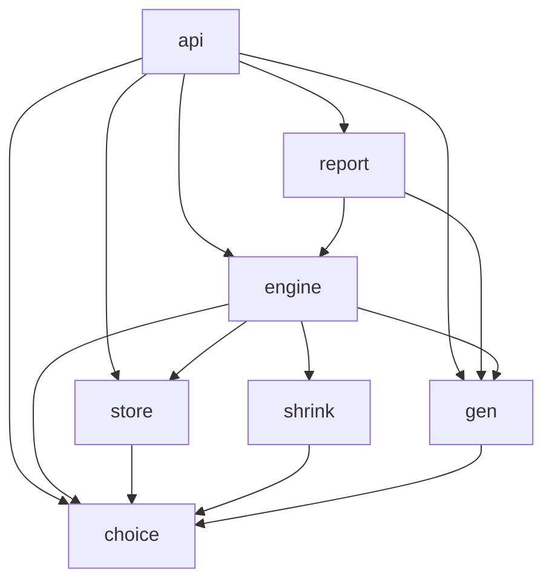

# Architecture

A property's body draws its inputs through a choice source, and every choice it makes is recorded as a natural number. A search runs the body on random choices until it fails. Shrinking then works on the record alone, never on the value, so a structured input shrinks whole.

The shrinker is a pure step function that imports nothing of grit's but `choice`, the bottom of seven layers that import downward alone. Only `api` and `store` touch I/O, so everything that generates, shrinks and reports is tested with no files and a fake clock.

## Choices

A choice is a natural number from 0 to its bound, and 0 is the simplest. Every generator is built on choices, by an encoding that gives simpler values at smaller choices: an integer zigzags out from the value it shrinks towards, and a float takes an order that puts simple floats first.

A run is one execution of the body. Its record is its sequence of choices. One sequence is smaller than another when it is shorter, or the same length and smaller at its first difference. That order, shortlex, is the one every part of grit means by smaller. A span is a stretch of consecutive choices in one sequence.

The choice source hands a run its choices. In generation it fills each at random, up to a limit on the choices one run may make. A candidate in shrinking, and a replay, hand over a fixed sequence and never fill, so a run that asks for more than the sequence holds ends there.

A run ends in one of four statuses:

| Status | Means |
|---|---|
| `overrun` | More choices asked for than the source holds, past a fixed sequence's end or generation's limit |
| `rejected` | An `assume` that was false, a filter that gave up, or a fixed sequence's choice above the bound its generator asks for |
| `returned` | A body that returned |
| `failed` | A body that threw |

## A search

A search is everything grit does for one property: its runs, its shrinking and its replays, ending in the property's outcome.



| Phase | Runs | Ends on |
|---|---|---|
| Generate | The body on random fills, one run after another | A failure, the run count spent, or too many runs rejected or overrun |
| First replay | The failing sequence again | The same failure, or anything else, which makes the outcome flaky |
| Shrink | The candidates the step function proposes | The step function's end, or the budget spent |
| Final replay | The smallest failing sequence | The error and the draws for the report, or anything else, which makes the outcome flaky |

A stored failure replays before generation starts. Where it fails, that failure stands as the first failure and the search goes straight to shrinking. A token passed to a property's `replay` setting replays that sequence alone, with no generation and no shrinking.

The outcome is a sealed type, one subtype a row:

| Outcome | Carries |
|---|---|
| Passed | The run count |
| Failed | The smallest failing sequence, its error and draws, the steps and time shrinking took, and the budget's bound that ran out, where one did |
| Flaky | The failing sequence, and the replay that did not fail as it did |
| Gave up | How many runs were rejected and overran |

Every outcome carries the search's warnings, a slow property among them. `runProperty` returns the outcome, and `property` and `forAll` are its bindings to `package:test`, failing the test on every outcome but passed. The report is a pure function of the outcome, the seed the search filled from and the settings it ran under, which it names so the search can be repeated.

## Shrinking

The shrinker is a step function: it proposes a candidate sequence, is told whether the candidate's run failed as the first failure did, and proposes the next. It is pure, so async, time and I/O stay with the engine, which drives it, awaits each run and holds the budget.

The engine decides what counts as the same failure: the same error type, thrown from the same frame. The frame is the first in the package of the property's call site, or where none is, the first outside the Dart SDK and every test package, grit's among them. A candidate that fails any other way is told to the shrinker as not failing, so a case never slips from one bug to another. Both replays hold to the same rule.

Why shrinking always ends:

- The shrinker accepts a candidate only where it is smaller than the current sequence and failed as the first did, so every accepted step descends shortlex.
- Shortlex over sequences no longer than the first failure, each choice within its bound, is finite, so the accepted steps are finitely many.
- Each pass proposes finitely many candidates from one sequence, and the passes are finitely many.
- The step function ends on a round of every pass that accepts nothing.

The budget then bounds how long shrinking takes, never whether it ends. It counts steps, each one run of a candidate, and wall time from shrinking's start, with defaults in `api`'s settings that no consumer has to set. The two replays are not steps, nor is a candidate the step function proposes again in one shrinking, which the engine tells its answer with no run. A spent budget ends shrinking at the smallest failing sequence found so far.

A pass is a function from the current sequence to its candidates, and the step function chooses among them:

- Deleting a span, alone and with the choice before it lowered by one, since that choice may be the span's length.
- Zeroing a span.
- Lowering a choice by binary search, over the pairs of choices an integer's zigzag puts at one distance, so a value lowers on either side of the one it shrinks towards.
- Lowering two choices by the same amount, so two values tied to each other fall together.
- Sorting a span, and swapping two.
- Moving value from one choice to another.

A pass for one kind of value, floats or strings, is added where shrink quality shows the need. It needs the record to carry each draw's span and its kind beside the sequence, since a bare sequence cannot say where a kind's choices sit, and that change is settled with the pass.

The step function's current sequence is always one it was told failed. The final replay then holds that every sequence the outcome reports as failed still fails.

## The clock

Wall time is read in two places alone:

- The budget's bound on shrinking.
- The slow-property warning.

Neither changes a verdict.

Each run is timed. A property whose runs are slow enough that its run count costs more than the engine's threshold gets a warning on its outcome, naming its time a run so its owner can lower the count. `api` prints it.

## The API

A property's body takes a `Draw` and pulls each input as it needs it. No arity is chosen up front, a draw can depend on one before it, and a body may be async and await as any test does:

```dart
property('sorting twice is sorting once', (draw) {
  final List<int> xs = draw(.list(.integer()));
  expect(sort(sort(xs)), sort(xs));
});
```

`Gen.build` takes a synchronous body of the same shape to make a reusable generator, and `Gen`'s static members are its generators, named by dot shorthand wherever a `Gen` is expected.

| Entry | Is |
|---|---|
| `property` | A test declared with no timeout, taking `test`'s other options |
| `forAll` | A search inside a test that stands, such as a `testWidgets`, bounded by that test's own timeout |
| `runProperty` | A search returning its outcome, with no test failed |
| `Draw.call` | A value drawn from a generator, with an optional label the report prints |
| `Draw.assume` | A run rejected where its condition is false |
| `Draw.note` | A line added to a failing run's report |

The public surface is `lib/grit.dart` alone, exporting `api`, `gen` and the outcome. The engine, the shrinker, the store and the choice source stay in `lib/src/`, each tested through its own public members there, the engine with the fake clock and the in-memory store.

## Generators

The rules every generator obeys:

- Choices: drawn only through the choice source, with no `Random` of its own and nothing else read.
- Simplest value: named in its doc comment, the one choice 0 gives.
- Collections: each element behind a "one more" choice, read as one more whatever it holds inside the minimum, and the collection ending on a choice of 0, one that can only be 0 at its maximum, so deleting a span deletes an element whole.
- Distribution: none of it. A generator sets only its choices' bounds and a "one more" choice's odds.

The bias towards a choice's bounds on early runs lives in the choice source's random fill, one home for every generator. A filter retries a bounded number of times, then rejects the run.

## Layers



| Layer | Holds | Imports |
|---|---|---|
| `api` | The entries, the settings and their defaults, the binding to `package:test`, and the composition root | `report`, `engine`, `store`, `gen`, `choice` |
| `report` | The outcome as the failure message | `engine`, `gen` |
| `engine` | The search: generation, the replays, the shrink driver under the budget, the warnings, the outcome, and every read of a stack | `store`, `shrink`, `gen`, `choice` |
| `store` | Failing sequences under `.dart_tool/grit/` | `choice` |
| `shrink` | The step function and its passes | `choice` |
| `gen` | `Gen`, `Draw`, and every generator and combinator | `choice` |
| `choice` | A choice, the sequence and its order, the token, the choice source and a run's status | Nothing of grit's |

The table is the rule's home, and the rules new code obeys are:

- An import reaches only the layers its row names, so none runs up.
- Only `api` imports `package:test`.
- Only `api` and `store` import `dart:io`.
- Only `api` builds a clock, a `Random` or a store, and every other layer is handed them by constructor.
- `choice`, `shrink` and `gen` are synchronous: no `Future`, no clock and no `Random` of their own.

Each layer is a directory under `lib/src/`. A new generator is a static member of `Gen` and a file under `lib/src/gen/`.

## Seams

The outside world reaches the layers below `api` through three seams:

- The clock, a monotonic elapsed time, which grit's own suite fakes below `api`, and which no verdict turns on, so no test of grit's turns on it.
- The `Random` the choice source fills from, seeded by a setting where a search must repeat.
- The store, with a file implementation and one in-memory fake.

No other I/O stands below `api`, and nothing writes outside the consumer's `.dart_tool/grit/`.

## The store

The store keeps each call site's smallest failing sequence in a file of its own under `.dart_tool/grit/`. Its key is the stack at the `property`, `forAll` or `runProperty` call, every frame of it in the consumer's package, by file and line. A property behind a helper is keyed by where the helper is called, and an edit above any of those lines loses its stored failure. Calls from one line in a loop share a key, so they replay each other's failure.

The store's file I/O is synchronous, since async file I/O can deadlock inside a `testWidgets`. A file is written to a temporary name and renamed, since `dart test` runs test files at once. A stored sequence whose replay does not fail, whatever its status, is deleted. The token printed on a failure is the same sequence encoded.

## Platform and packages

The web would change three things:

- `dart:io`, which the layer rules keep to `api` and `store`.
- A stack's form, read in `engine` alone.
- A bound's width under dart2js, held in `choice`.

So the web is a later cut of those parts and not a rewrite.

grit is one package. A Flutter package under `fixture/flutter/` resolves it beside `flutter_test` and runs it inside a `testWidgets`, since `flutter_test` pins the `test_api` that grit's `test` must match. A Lean package under `lean/` models the step function and proves the proof's statements, which `CLAUDE.md`'s intent holds, and a grit property ties the model to the Dart code ([proofs.md](proofs.md)).

## Testing grit

The shrinking challenge is a public set of shrinking problems, each with the smallest case known (jlink/shrinking-challenge on GitHub). It is a suite under `test/challenge/`, one file a challenge, each driving the engine under the default settings on fixed seeds, the fake clock and, once it stands, the in-memory store, and asserting the smallest sequence's value against the smallest known, so a fall in shrink quality fails the suite.

A challenge is held to each of the seeds from 0 to 9 whose search reaches the smallest known, and its file names each seed it leaves out and why. One whose failure the default search never finds is driven from fixed failing starts instead, so its shrinking is held all the same.

grit departs from the stack's property-test row, which names glados, since it is the library that replaces it. Before `property` runs, a property a layer's issue carries is checked over every sequence up to a small length and bound, by plain loops in the test. Those checks stay once grit stands, beside the same property written on grit over larger inputs.

## Why this model

The engine is Hypothesis's model, in the small form minithesis gives it.

Why shrinking works on the record of choices:

- A generator built by `map`, `filter` or `Gen.build` shrinks with no shrinker of its own, since every value it makes is a function of the choices beneath it.
- A structured input shrinks whole, since deleting a span deletes a part of the value, wherever in it that part sits.
- A failure is stored and replayed as its choices, so a stored failure outlives a change to how its value prints.

Why every choice is a bounded natural:

- One order serves every kind of value, so the shrinker holds one set of passes, and the proof one order.
- A kind of value whose choices shrink poorly takes a pass of its own over the same naturals, so the order never grows a type per kind.

Why the body draws its inputs:

- Dart has no variadic generics, so a property of fixed arity needs a function for each arity.
- A draw that depends on an earlier one is a plain line of the body, with no `bind`.
- An async body awaits as any test's does.
